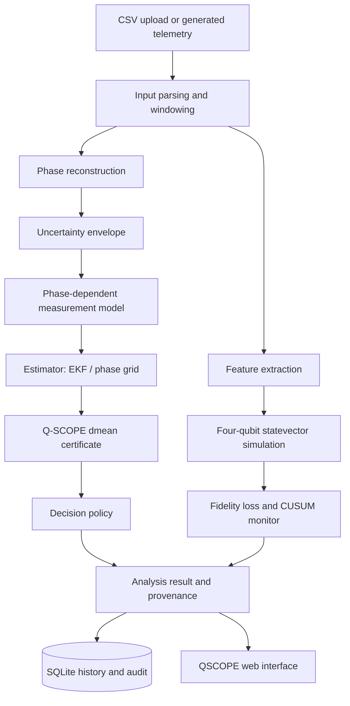

# QSCOPE

### Quantum Sensor Condition Observation & Prognostics Engine

QSCOPE is a research-oriented software platform for analysing atom-interferometer-style measurements, examining uncertainty in nonlinear phase-dependent readout, producing a model-discrepancy risk certificate, and exploring estimator decision policies. It combines a FastAPI backend, a React-based web interface, SQLite history and audit storage, and a **classically simulated statevector monitoring branch**.

> **Research prototype:** QSCOPE is not currently a validated safety-critical instrument or a demonstrated quantum-hardware application. Sample telemetry and the live visual demo can be synthetic. The statevector monitor runs in software; this project does not claim quantum advantage or real-hardware validation.


---

## Contents

- [What QSCOPE does](#what-qscope-does)
- [Minimal working prototype](#minimal-working-prototype)
- [System architecture](#system-architecture)
- [Implementation details](#implementation-details)
- [Q-SCOPE discrepancy indicator](#q-scope-discrepancy-indicator)
- [Statevector monitoring branch](#statevector-monitoring-branch)
- [Technology stack](#technology-stack)
- [Project structure](#project-structure)
- [Getting started](#getting-started)
- [Running the tests](#running-the-tests)
- [API overview](#api-overview)
- [Sample data and provenance](#sample-data-and-provenance)
- [Limitations and responsible use](#limitations-and-responsible-use)
- [Roadmap](#roadmap)
- [References](#references)

## What QSCOPE does

QSCOPE is designed around a practical question in nonlinear quantum-sensor readout:

**When should an estimator's output be treated cautiously because the measurement model, uncertainty assumptions, or available data may not support it?**

The current codebase brings together these capabilities:

- **Measurement ingestion:** CSV upload and window-based processing for telemetry-like data.
- **Phase and uncertainty processing:** phase reconstruction components and uncertainty-envelope models, including explicitly simulated reconstruction paths.
- **Measurement modelling:** a fringe-style, phase-dependent population model.
- **Estimator components:** an Extended Kalman Filter (EKF) and a phase-grid estimator, with additional estimator interfaces in the codebase.
- **Risk certificate:** a `dmean` discrepancy indicator intended to quantify the difference between an uncertainty-aware nonlinear prediction and a prediction evaluated at the mean phase.
- **Decision-policy prototype:** policy components for retaining the EKF, recommending a nonlinear estimator, or abstaining where policy and evidence justify it. Exact outcomes depend on the route and code path; this is not yet a fully validated operational policy.
- **Condition monitoring:** feature extraction, baseline normalisation, statevector overlap/fidelity calculations, and a CUSUM-style drift accumulator.
- **Traceability:** SQLite-backed analysis history and audit records, with JSON and CSV export endpoints.
- **Web interface:** a light-theme React UI with Overview, Analyze, Risk Certificates, Runs & Audit, and Health Monitor views.

## Minimal working prototype

The repository contains the working software prototype: a FastAPI backend, a React/Vite frontend, analysis and decision modules, a SQLite-backed history/audit layer, tests, configuration profiles, and synthetic sample telemetry for local demonstration. The code is included in the repository; setup steps below explain how to run the API and frontend locally.

This is a research prototype. The presence of an implemented endpoint or a successful HTTP response confirms software behaviour for that request, not scientific accuracy, real sensor acquisition, or hardware validation.

## System architecture



The statevector monitor is a separate software-simulation branch; it is not a physical quantum processor and does not replace the classical risk-certificate calculation.

## Q-SCOPE discrepancy indicator

The project explores a discrepancy score of the form

\[
B = \frac{\left|\mathbb{E}[p(\phi)] - p(\mu)\right|}
{\sqrt{\operatorname{Var}[p(\phi)] + \frac{1}{4N}}}
\]

where:

- \(p(\phi)\) is the phase-dependent measurement probability under the chosen measurement model.
- \(\phi\) is the uncertain phase variable.
- \(\mu\) is the mean phase.
- \(N\) is the atom/shot count used by the model's shot-noise term.
- The expectation and variance are evaluated under the uncertainty model used by the implementation.

The configured fringe model uses parameters such as offset, amplitude, contrast, and phase offset. The default threshold in the configuration is **illustrative**, not a hardware safety limit.

**Interpretation boundary:** `B` is a model-discrepancy indicator. It must not be interpreted as a calibrated probability of EKF failure unless further calibration, independent reference labels, and held-out validation support that interpretation.

## Statevector monitoring branch

The optional monitoring branch includes:

1. Window-level features: mean, standard deviation, slope, and mean absolute difference.
2. Baseline normalisation of those features into encoding angles.
3. A four-wire statevector feature encoder.
4. State-overlap fidelity against a reference state derived from calibration features.
5. Fidelity-loss accumulation with a CUSUM-style alert rule.

The built-in backend uses NumPy-based classical statevector simulation. Optional Qiskit and PennyLane integrations are listed separately in `requirements-quantum.txt`; they do not imply execution on quantum hardware. The monitor's starting thresholds are illustrative and require calibration against appropriate healthy baseline data before meaningful operational interpretation.

## Implementation details

The current implementation is organised into these stages:

1. **Input and windowing:** CSV ingestion and processing-window preparation.
2. **Phase reconstruction:** phase-related quantities are produced by the configured reconstruction component; some paths are explicitly simulated.
3. **Uncertainty propagation:** the configured uncertainty model supplies the phase uncertainty used by downstream calculations.
4. **Measurement model:** a phase-dependent fringe-style model predicts measurement populations.
5. **Estimation:** estimator modules provide the available EKF and phase-grid paths.
6. **Risk certificate and decision:** the `dmean` indicator compares an uncertainty-aware nonlinear prediction with the prediction evaluated at the mean phase; decision-policy code maps supported inputs to the available action states.
7. **Persistence and traceability:** analysis records and audit events can be stored in SQLite and exported through the API.
8. **Monitoring branch:** extracted window features feed a NumPy-based classical statevector simulation and CUSUM-style monitor. This branch is simulation, not execution on quantum hardware.

Implementation details and input/output contracts are defined in the source modules and the running FastAPI documentation at `/docs`. Configuration profiles are in `configs/`; automated checks are in `tests/`.

## Technology stack

| Layer | Technologies |
|---|---|
| Backend API | Python, FastAPI, Uvicorn, Pydantic |
| Scientific computation | NumPy and Python numerical/statistical code |
| Estimation and analysis | EKF, phase-grid estimator, measurement-model and uncertainty components |
| Statevector simulation | NumPy-based simulator; optional Qiskit and PennyLane backends |
| Persistence | SQLite |
| Frontend | React 18, Vite, Tailwind CSS, Lucide icons |
| Tests | Pytest, FastAPI TestClient / HTTPX |

## Project structure

```text
.
├── app/                         # FastAPI application, models, and routes
├── core/                        # Contracts, pipeline orchestration, config, registry
├── configs/                     # Default, simulation, and experimental profiles
├── data/                        # Sample data and metadata
├── frontend/
│   ├── public/assets/           # Static assets, including QSCOPE grain texture
│   └── src/
│       ├── components/          # Application views and UI components
│       └── services/             # Frontend API functions
├── modules/
│   ├── data_sources/            # CSV, synthetic, and adapter components
│   ├── decision_policies/       # Decision policy and cost model
│   ├── estimators/              # EKF, phase-grid, and other estimator components
│   ├── measurement_models/      # Fringe model and calibration components
│   ├── monitoring/              # Feature extraction and CUSUM monitoring
│   ├── phase_reconstruction/    # Phase reconstruction components
│   ├── preprocessing/           # Validation, synchronisation, and windowing
│   ├── quantum_simulation/      # Statevector and optional backend integrations
│   ├── risk_certificates/       # dmean certificate and uncertainty-envelope logic
│   └── uncertainty/             # Distribution models and uncertainty propagation
├── services/                    # Analysis, decision, and history services
├── storage/                     # SQLite repository, audit writer, and exports
├── tests/                       # API and quantum-simulation tests
├── generate_data.py             # Generate synthetic sample telemetry
├── requirements.txt             # Core Python dependencies
└── requirements-quantum.txt     # Optional quantum-library dependencies
```

## Getting started

### Prerequisites

- Python **3.10 or newer**
- Node.js and npm (for the frontend)
- Git (recommended)

Run the commands below from the repository root — the directory containing `app/`, `frontend/`, and `requirements.txt`.

### 1. Create and activate a Python environment

**Windows PowerShell**

```powershell
py -3 -m venv .venv
.\.venv\Scripts\Activate.ps1
python -m pip install --upgrade pip
pip install -r requirements.txt
```

**macOS / Linux**

```bash
python3 -m venv .venv
source .venv/bin/activate
python -m pip install --upgrade pip
pip install -r requirements.txt
```

### 2. Start the backend

From the repository root, with the virtual environment activated:

```bash
python -m uvicorn app.main:app --host 127.0.0.1 --port 8000 --reload
```

The backend should be available at:

- API: <http://127.0.0.1:8000>
- Interactive API documentation: <http://127.0.0.1:8000/docs>
- Health endpoint: <http://127.0.0.1:8000/health>

Keep this terminal running.

### 3. Start the frontend

Open a second terminal and run:

```bash
cd frontend
npm install
npm run dev
```

Open <http://localhost:3000> in your browser.

The Vite development server is configured to proxy the API routes to `http://127.0.0.1:8000`. Run the backend first so the frontend can retrieve service status and submit analyses.

### 4. Generate sample telemetry (optional)

From the repository root:

```bash
python generate_data.py
```

This generates `data/sample_mission.csv` using the synthetic data source. Check `data/sample_metadata.json` for the metadata and provenance notes associated with the sample dataset.

### 5. Build the frontend (optional)

From the `frontend/` directory:

```bash
npm run build
npm run preview
```

## Running the tests

From the repository root, activate the Python environment and run:

```bash
python -m pytest tests
```

The included tests cover API endpoints, analysis output structure, statevector encoding, feature extraction, fidelity calculations, baseline normalisation, and CUSUM monitoring. Test results depend on the local environment and installed dependencies; run them in your own checkout to confirm the current state.

The statevector module also exposes a self-test mode:

```bash
python -m modules.quantum_simulation.quantum_monitor --selftest
```

## API overview

FastAPI's interactive documentation at `/docs` is the source of truth for request models and response fields.

| Method | Endpoint | Purpose |
|---|---|---|
| `GET` | `/` | Project/API information |
| `GET` | `/health` | Service health summary |
| `GET` | `/version` | Version and configuration information |
| `POST` | `/upload-csv` | Upload CSV telemetry and create processing windows |
| `POST` | `/analyze-window` | Run the analysis pipeline for a window or supplied arrays |
| `POST` | `/decision` | Evaluate the decision endpoint's certificate/policy path |
| `GET` | `/history` | Retrieve paginated analysis history; accepts `page`, `limit`, and optional `run_id` |
| `GET` | `/audit-log` | Retrieve audit records |
| `GET` | `/export?format=json` | Export history as JSON; `format=csv` requests CSV |
| `GET` | `/quantum/status` | Inspect statevector monitor status |
| `POST` | `/quantum/reset` | Reset a monitor accumulator; optional `key` query parameter |
| `POST` | `/quantum/calibrate` | Calibrate a monitor baseline |
| `POST` | `/quantum/monitor-window` | Monitor a single signal window or supplied feature set |
| `POST` | `/quantum/stream` | Process a signal as a sequence of windows |

Example health check:

```bash
curl http://127.0.0.1:8000/health
```

## Sample data and provenance

The repository contains sample telemetry and metadata intended for development and demonstration. Review the accompanying metadata before interpreting the fields. Sample files must not be treated as measurements from a real atom interferometer unless independently verified provenance establishes that.

The frontend also contains simulated/live-demo behaviours for visualising the pipeline. A moving signal, successful API response, or statevector status is not by itself evidence of real sensor acquisition or scientific accuracy.

## Limitations and responsible use

QSCOPE is a research prototype. Before using it with real instruments or in decisions with safety implications, the following work is needed:

- Validate input schemas, minimum sample counts, units, timestamp alignment, calibration metadata, and uncertainty handling.
- Confirm the measurement-model assumptions and estimator behaviour against independently verified reference data.
- Calibrate the risk indicator and its decision threshold using appropriate training and held-out evaluation data.
- Evaluate false alarms, missed high-risk cases, robustness to uncertainty mis-specification, and performance across relevant noise regimes.
- Confirm the semantics and provenance of any external experimental dataset before using it as validation evidence.
- Calibrate monitoring thresholds against suitable real baseline data before interpreting alerts operationally.
- Review API authentication, CORS policy, input limits, state-changing endpoints, storage, logging, and deployment configuration before exposing the service publicly.

The current statevector branch is a **classical simulation**. It does not control a quantum processor, and no quantum-computing advantage is claimed. The project is not a production-certified sensor controller or a substitute for instrument calibration and expert review.

## Roadmap

- Strengthen input validation and provenance propagation throughout the pipeline.
- Clarify and test abstention and estimator-escalation behaviour end to end.
- Validate the discrepancy certificate with independent reference labels and held-out operating conditions.
- Evaluate uncertainty calibration and risk/decision performance across multiple noise families.
- Improve the experimental-data adapters only after data-field semantics and reference quantities are verified.
- Add robust deployment configuration, access controls, and repeatable evaluation reports.

## References

- [IBM Quantum Platform](https://quantum.cloud.ibm.com/) — visual reference for the technical cloud-application interface.
- [FastAPI documentation](https://fastapi.tiangolo.com/) — backend API framework.
- [React documentation](https://react.dev/) — frontend library.
- [Vite documentation](https://vite.dev/) — frontend development and build tooling.
- [NumPy documentation](https://numpy.org/doc/) — numerical computation and the built-in statevector simulation.
- [Qiskit documentation](https://docs.quantum.ibm.com/) — optional quantum software integration.
- [PennyLane documentation](https://docs.pennylane.ai/) — optional quantum software integration.

---

## Repository hygiene before publishing

Do not commit a local virtual environment, Node dependencies, build output, local databases, credentials, or private sensor files. A useful `.gitignore` baseline is:

```gitignore
# Python
.venv/
venv/
__pycache__/
*.py[cod]
.pytest_cache/

# Frontend
frontend/node_modules/
frontend/dist/

# Local state and secrets
*.db
.env
.env.*
!.env.example

# Uploaded telemetry (keep only intentionally public sample data)
data/uploaded_live.csv
```

If a database or uploaded data file is already tracked by Git, adding it to `.gitignore` does not remove it from history; remove it from the index and review the repository history before publishing sensitive data.
